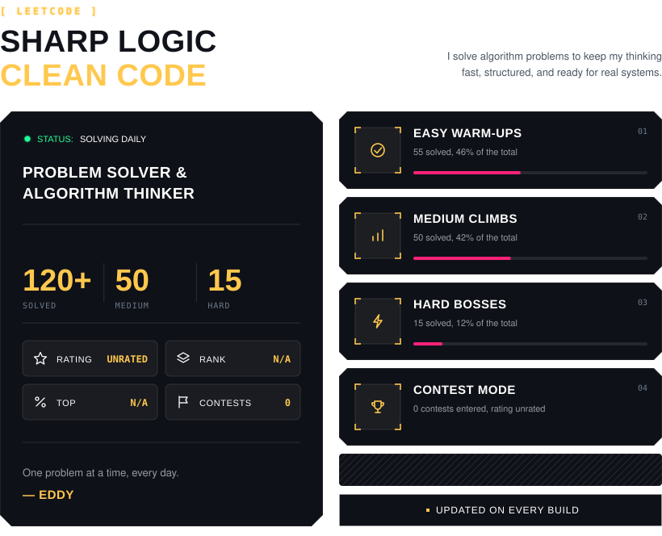
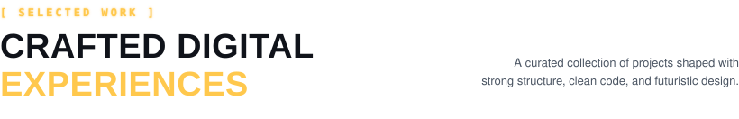
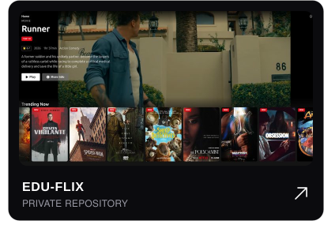

<table align="center" width="820" cellpadding="0" cellspacing="0" border="0">
<tr><td colspan="5" valign="top"><a href="#top"><picture><source media="(prefers-color-scheme: dark)" srcset="generated/hero_top_dark.svg"><source media="(prefers-color-scheme: light)" srcset="generated/hero_top_light.svg"></picture></a></td></tr>
<tr>
<td valign="top"><a href="#top"><picture><source media="(prefers-color-scheme: dark)" srcset="generated/hero_a_dark.svg"><source media="(prefers-color-scheme: light)" srcset="generated/hero_a_light.svg"></picture></a></td>
<td valign="top"><a href="#selected-work"><picture><source media="(prefers-color-scheme: dark)" srcset="generated/hero_work_dark.svg"><source media="(prefers-color-scheme: light)" srcset="generated/hero_work_light.svg"></picture></a></td>
<td valign="top"><a href="#top"><picture><source media="(prefers-color-scheme: dark)" srcset="generated/hero_gap_dark.svg"><source media="(prefers-color-scheme: light)" srcset="generated/hero_gap_light.svg"></picture></a></td>
<td valign="top"><a href="#signal-uplink"><picture><source media="(prefers-color-scheme: dark)" srcset="generated/hero_hello_dark.svg"><source media="(prefers-color-scheme: light)" srcset="generated/hero_hello_light.svg"></picture></a></td>
<td valign="top"><a href="#top"><picture><source media="(prefers-color-scheme: dark)" srcset="generated/hero_rest_dark.svg"><source media="(prefers-color-scheme: light)" srcset="generated/hero_rest_light.svg"></picture></a></td>
</tr>
<tr><td colspan="5" valign="top"><a href="#top"><picture><source media="(prefers-color-scheme: dark)" srcset="generated/hero_bottom_dark.svg"><source media="(prefers-color-scheme: light)" srcset="generated/hero_bottom_light.svg"></picture></a></td></tr>
</table>

~ live session · Eddy Odero@github · re-renders every build ~

  

<a href="#s1"><picture><source media="(prefers-color-scheme: dark)" srcset="generated/stats_strip.svg"><source media="(prefers-color-scheme: light)" srcset="generated/stats_strip_light.svg"></picture></a>

  

<a href="#s2"><picture><source media="(prefers-color-scheme: dark)" srcset="generated/skill_modules.svg"><source media="(prefers-color-scheme: light)" srcset="generated/skill_modules_light.svg"></picture></a>

  

  

<a href="#s4"><picture><source media="(prefers-color-scheme: dark)" srcset="generated/leetcode_panel.svg"><source media="(prefers-color-scheme: light)" srcset="generated/leetcode_panel_light.svg"></picture></a>

  

<a href="#s5"><picture><source media="(prefers-color-scheme: dark)" srcset="generated/event_log.svg"><source media="(prefers-color-scheme: light)" srcset="generated/event_log_light.svg"></picture></a>

  

<a href="#selected-work"><picture><source media="(prefers-color-scheme: dark)" srcset="generated/fragment_heading.svg"><source media="(prefers-color-scheme: light)" srcset="generated/fragment_heading_light.svg"></picture></a>

 

<table align="center" width="820" cellpadding="0" cellspacing="0" border="0">
<tr>
<td align="left" valign="top">

</td>
<td align="right" valign="top">

</td>
</tr>
<tr>
<td align="left" valign="top">

</td>
<td align="right" valign="top">

</td>
</tr>
</table>

  

<a href="#signal-uplink"><picture><source media="(prefers-color-scheme: dark)" srcset="generated/signal_heading.svg"><source media="(prefers-color-scheme: light)" srcset="generated/signal_heading_light.svg"></picture></a>

<table align="center" width="820" cellpadding="0" cellspacing="0" border="0"><tr><td align="left">
&nbsp;&nbsp;&nbsp;&nbsp;</td></tr></table>

<a href="#s6"><picture><source media="(prefers-color-scheme: dark)" srcset="generated/signal_status.svg"><source media="(prefers-color-scheme: light)" srcset="generated/signal_status_light.svg"></picture></a>

  

<a href="#s7"><picture><source media="(prefers-color-scheme: dark)" srcset="generated/activity_heading.svg"><source media="(prefers-color-scheme: light)" srcset="generated/activity_heading_light.svg"></picture></a>

<a href="#s8"><picture><source media="(prefers-color-scheme: dark)" srcset="generated/neural_activity.svg"><source media="(prefers-color-scheme: light)" srcset="generated/neural_activity_light.svg"></picture></a>

<table align="center" width="820" cellpadding="0" cellspacing="0" border="0"><tr><td align="left">
&nbsp;&nbsp;click any building to see that week's commits
</td></tr></table>

<a href="#s9"><picture><source media="(prefers-color-scheme: dark)" srcset="generated/activity_status.svg"><source media="(prefers-color-scheme: light)" srcset="generated/activity_status_light.svg"></picture></a>

Last rendered: 2026-11-19 07:54 UTC · theme: hud · auto-generated, do not edit by hand