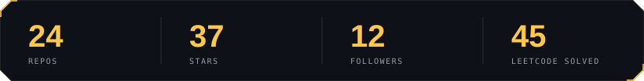
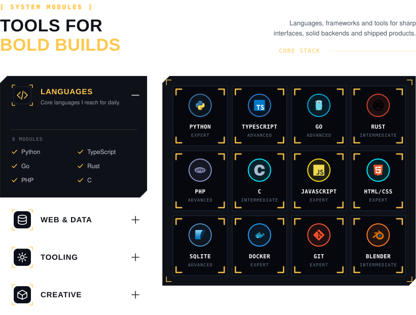
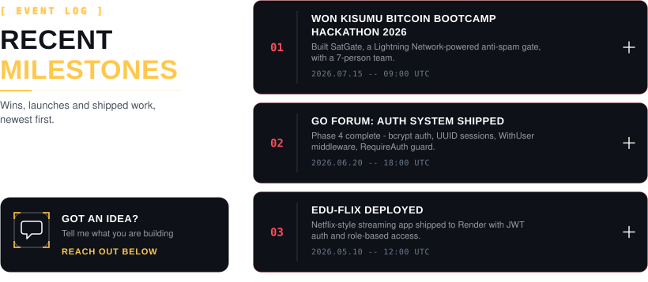
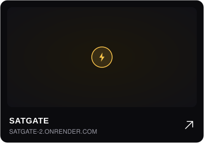

<a href="#top"><picture><source media="(prefers-color-scheme: dark)" srcset="generated/terminal.svg"><source media="(prefers-color-scheme: light)" srcset="generated/terminal_light.svg"></picture></a>

~ live session · Eddy Odero@github · re-renders every build ~

  

<a href="#s1"><picture><source media="(prefers-color-scheme: dark)" srcset="generated/stats_strip.svg"><source media="(prefers-color-scheme: light)" srcset="generated/stats_strip_light.svg"></picture></a>

  

<a href="#s2"><picture><source media="(prefers-color-scheme: dark)" srcset="generated/skill_modules.svg"><source media="(prefers-color-scheme: light)" srcset="generated/skill_modules_light.svg"></picture></a>

  

  

<a href="#s4"><picture><source media="(prefers-color-scheme: dark)" srcset="generated/leetcode_panel.svg"><source media="(prefers-color-scheme: light)" srcset="generated/leetcode_panel_light.svg"></picture></a>

  

<a href="#s5"><picture><source media="(prefers-color-scheme: dark)" srcset="generated/event_log.svg"><source media="(prefers-color-scheme: light)" srcset="generated/event_log_light.svg"></picture></a>

  

<a href="#selected-work"><picture><source media="(prefers-color-scheme: dark)" srcset="generated/fragment_heading.svg"><source media="(prefers-color-scheme: light)" srcset="generated/fragment_heading_light.svg"></picture></a>

 

 
 

  

<a href="#signal-uplink"><picture><source media="(prefers-color-scheme: dark)" srcset="generated/signal_heading.svg"><source media="(prefers-color-scheme: light)" srcset="generated/signal_heading_light.svg"></picture></a>

<a href="#s6"><picture><source media="(prefers-color-scheme: dark)" srcset="generated/signal_status.svg"><source media="(prefers-color-scheme: light)" srcset="generated/signal_status_light.svg"></picture></a>

  

<a href="#s7"><picture><source media="(prefers-color-scheme: dark)" srcset="generated/activity_heading.svg"><source media="(prefers-color-scheme: light)" srcset="generated/activity_heading_light.svg"></picture></a>

<a href="#s8"><picture><source media="(prefers-color-scheme: dark)" srcset="generated/neural_activity.svg"><source media="(prefers-color-scheme: light)" srcset="generated/neural_activity_light.svg"></picture></a>

<a href="#s9"><picture><source media="(prefers-color-scheme: dark)" srcset="generated/activity_status.svg"><source media="(prefers-color-scheme: light)" srcset="generated/activity_status_light.svg"></picture></a>

Last rendered: 2026-11-20 05:09 UTC · theme: hud · auto-generated, do not edit by hand